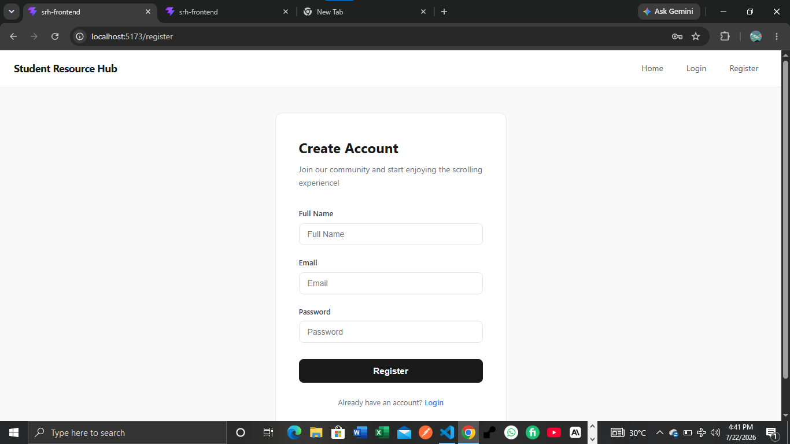
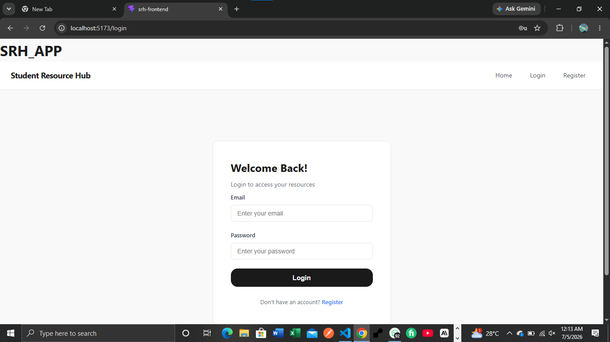
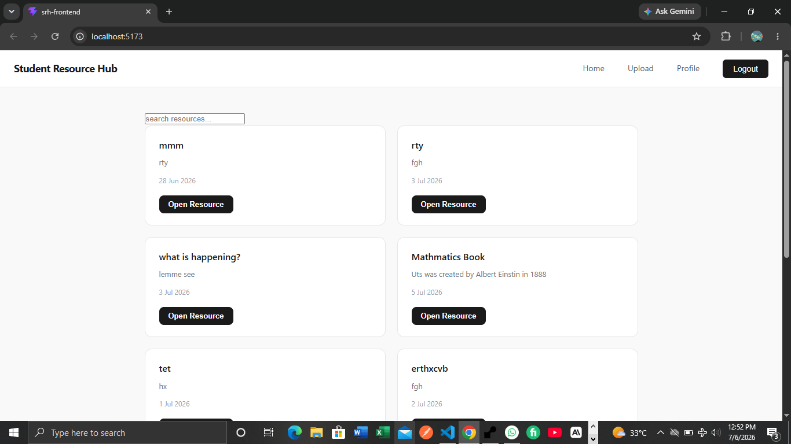
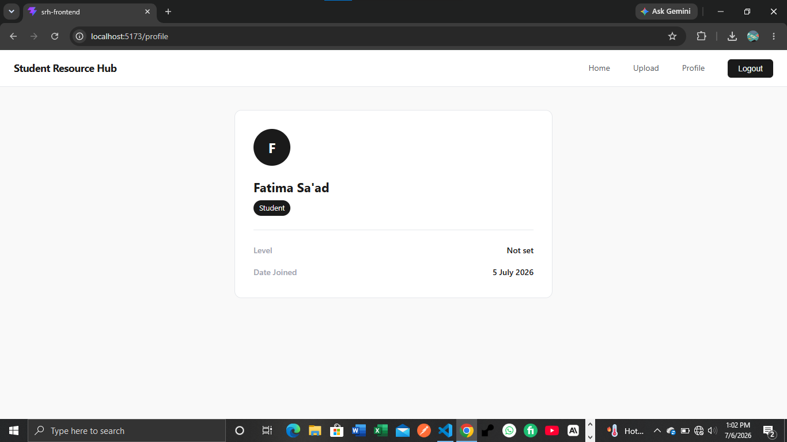
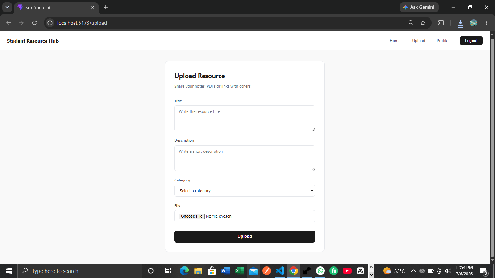
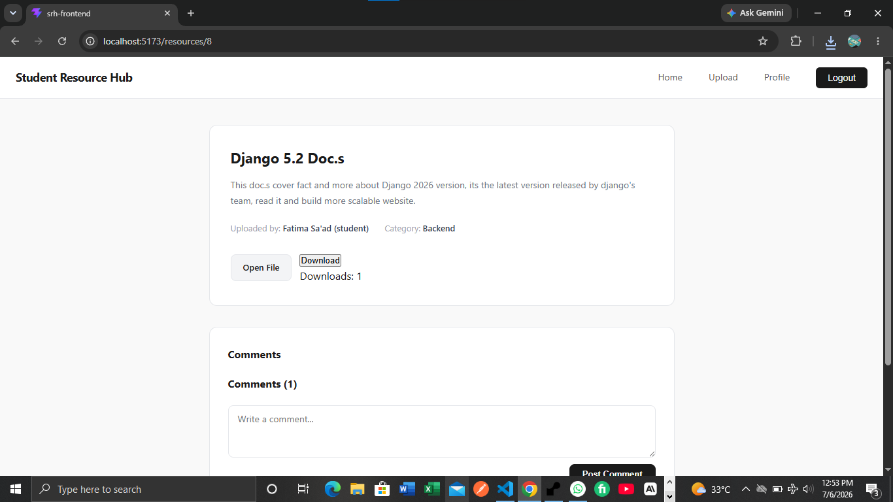

# Student Resource Hub

A full-stack web application where students and lecturers can upload, browse, search, and download academic resources. Installable as a Progressive Web App.

**Live Demo:** https://srh-frontend.vercel.app  
**Backend API:** https://student-resource-hub-qx57.onrender.com  
**Hire me:** https://fiverr.com/s/Q78QpXP

---

## What it does

- Students and lecturers register and log in with JWT authentication, selecting their Faculty, Department, and Level at registration
- Show/hide password toggle on login and registration
- Forgot password and reset by email (link expires in 5 minutes, single use, rate limited)
- Change password from your profile
- Browse and search academic resources by title
- Upload resources (PDFs, images, or links) with category and description
- New uploads go through a moderation queue and need approval before appearing publicly
- In-browser PDF preview and image viewing
- Download resources with a download counter
- Rate resources (1-5 stars) and comment on them
- Edit or delete your own resources (ownership enforced on the backend)
- See every resource you've uploaded on your profile page
- Auth-aware navigation: guests see different links from logged-in users
- Protected routes: upload, comment, rate, and download require authentication
- Profile page showing name, role, faculty, department, level, and join date
- Persistent top + bottom navigation (Home, Search, Upload, Profile)
- Full dark / light / system theme support
- Installable PWA with offline-ready app shell and auto-updating service worker

---

## Tech Stack

**Frontend**
- React 18 (Vite)
- React Router v6
- Context API for global auth and theme state
- `vite-plugin-pwa` for the manifest and service worker
- `lucide-react` icons
- Plain CSS with CSS variables for theming
- Deployed on Vercel

**Backend**
- Django 5.2 + Django REST Framework
- Simple JWT authentication
- PostgreSQL
- Cloudinary (file storage)
- Resend (transactional email for password reset)
- Deployed on Render

---

## Project Structure

```text
public/
└── icons/
    ├── icon-192.png
    ├── icon-512.png
    ├── maskable-512.png
    └── apple-touch-icon.png
src/
├── api.js
├── context/
│   ├── AuthContext.jsx
│   └── ThemeContext.jsx
├── hooks/
│   └── useFetch.js
└── components/
    ├── Navbar.jsx
    ├── Layout.jsx
    ├── ResourceCard.jsx
    ├── ResourceDetail.jsx
    ├── ResourceList.jsx
    ├── LoginForm.jsx
    ├── RegisterForm.jsx
    ├── ForgotPassword.jsx
    ├── ResetPassword.jsx
    ├── ChangePassword.jsx
    ├── UploadForm.jsx
    ├── EditResource.jsx
    ├── Profile.jsx
    ├── Comments.jsx
    ├── Rating.jsx
    ├── PendingSubmissions.jsx
    └── DownloadResource.jsx
```

## Screenshots

### Registration
<p align="center"></p>

### Login
<p align="center"></p>

### Resources List
<p align="center"></p>

### Profile
<p align="center"></p>

### Upload Resource
<p align="center"></p>

### Resource Details
<p align="center"></p>

### Pending Submissions (Moderator)
<p align="center"></p>

### Dark Mode
<p align="center"></p>

---

## Running Locally

```bash
# Install dependencies
npm install

# Create .env file
VITE_API_URL=http://127.0.0.1:8000/api

# Start development server
npm run dev
```

To test the PWA (the service worker only runs on a production build):

```bash
npm run build
npm run preview
```

## Backend Repository
Django REST Framework API: [student-resource-hub](https://github.com/Houzsaad/student-resource-hub)

## Roadmap
- Email delivery to all users (needs a verified custom domain)
- Custom domain
- Multiple image upload per resource (1-4 images)
- Department-scoped resource visibility

## Author
Huzaifa Sa'ad

Self-taught fullstack developer: Django + React

📧 houzsaad@gmail.com  
🐙 github.com/Houzsaad  
💼 fiverr.com/s/Q78QpXP
